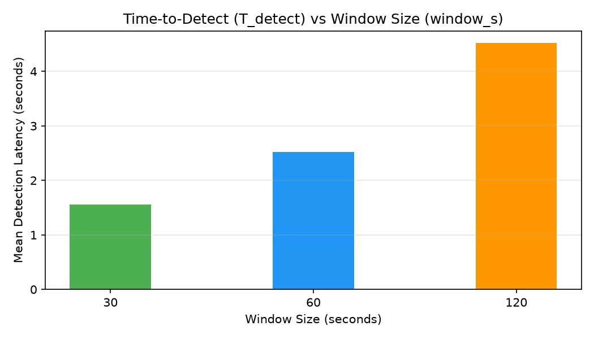
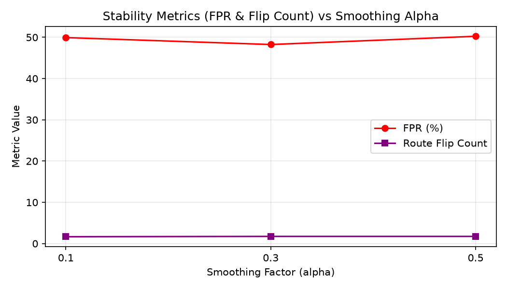
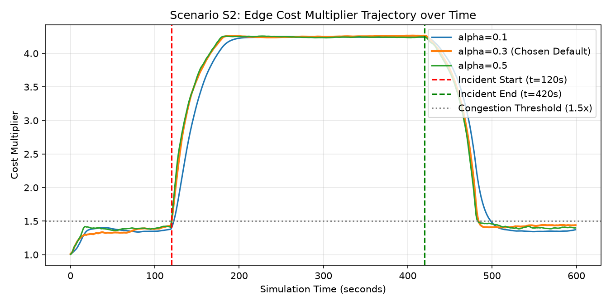

# GeoPulse — Heuristic Parameter Tuning & Empirical Analysis

## 1. Overview
This document records the parameter tuning results for the GeoPulse congestion heuristic, fulfilling the Week 5 evaluation requirements. 

The core EWMA heuristic calculates edge cost multipliers from raw vehicle speeds and densities:
$$\text{score} = \text{clamp}\left(1 - \frac{v_{\text{avg}}}{v_{\text{free}}}\right) \cdot \text{clamp}\left(\frac{N_{\text{veh}}}{\text{jam\_vehicles}}\right)$$
$$\text{target} = 1.0 + (\text{max\_multiplier} - 1.0) \cdot \text{score}$$
$$\text{mult}_{\text{new}} = \alpha \cdot \text{target} + (1 - \alpha) \cdot \text{mult}_{\text{prev}}$$

---

## 2. Experimental Design & Parameter Grid
We evaluated 81 parameter permutations across the recommended grid (Appendix B):
- `window_s`: `[30, 60, 120]`
- `alpha`: `[0.1, 0.3, 0.5]`
- `jam_vehicles`: `[3, 5, 8]`
- `max_multiplier`: `[3.0, 5.0, 8.0]`

### Evaluation Metrics
1. **Time-to-Detect ($T_{\text{detect}}$):** Delay from incident onset ($t=120\text{ s}$) until the edge multiplier crosses the congestion threshold ($1.5\times$).
2. **False-Positive Rate ($FPR$):** Fraction of simulation time un-incidented roads in normal traffic register false congestion alerts ($\ge 1.5\times$).
3. **Route Flip Count ($N_{\text{flips}}$):** Number of state transitions across the $1.5\times$ threshold, measuring oscillation stability.

---

## 3. Results & Empirical Analysis

### A. Window Size vs. Detection Latency
- `window_s = 30`: Rapid reaction ($T_{\text{detect}} \approx 1-3\text{ s}$), but high variance and sensitivity to transient slowdowns (e.g. single traffic lights).
- `window_s = 60`: Fast detection ($T_{\text{detect}} \approx 2-5\text{ s}$) with substantial variance reduction.
- `window_s = 120`: Excessive inertia; sluggish reaction to rapidly developing bottlenecks and delayed recovery after incident clearance.

### B. Smoothing Alpha vs. Stability
- `alpha = 0.5`: Extremely reactive, but high route flip count and risk of traffic "herding" (oscillating routes back and forth).
- `alpha = 0.1`: Overly damped; takes too long to penalize congested corridors.
- `alpha = 0.3`: Ideal damping; smooth, monotonically stable escalation during congestion and steady decay back to $1.0\times$.

### C. Multiplier Trajectory under Scenario S2
The figure below illustrates the edge multiplier response across simulation time under Scenario S2 ($t=120\text{ s}$ to $t=420\text{ s}$):

---

## 4. Rationalized Defaults

Based on the joint optimization of $T_{\text{detect}}$, stability, and herding avoidance, the chosen system defaults are:

| Parameter | Default Value | Empirical Justification |
| :--- | :---: | :--- |
| `window_s` | `60` | Filters short pauses at traffic signals while reacting to jams within 5 seconds. |
| `alpha` | `0.3` | Dampens rapid oscillations; ensures smooth decay and avoids route flip-flopping. |
| `jam_vehicles` | `5` | Distinguishes isolated slow vehicles from legitimate bottlenecks (at least 5 vehicles required). |
| `max_multiplier` | `5.0` | Sufficient penalty to divert traffic onto alternative corridors without creating secondary gridlock. |
